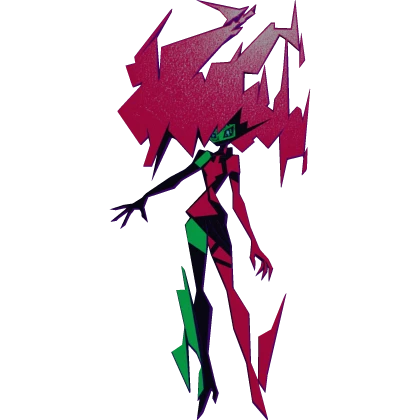
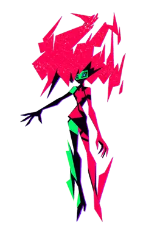
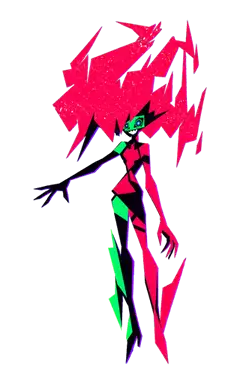
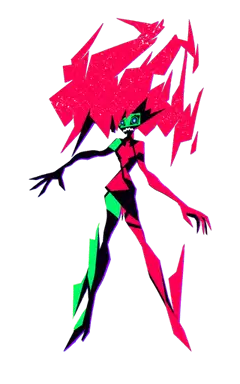
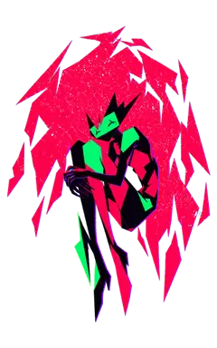
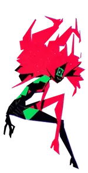
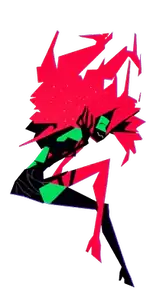
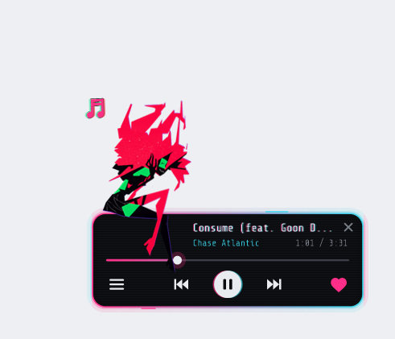
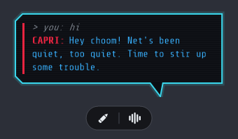
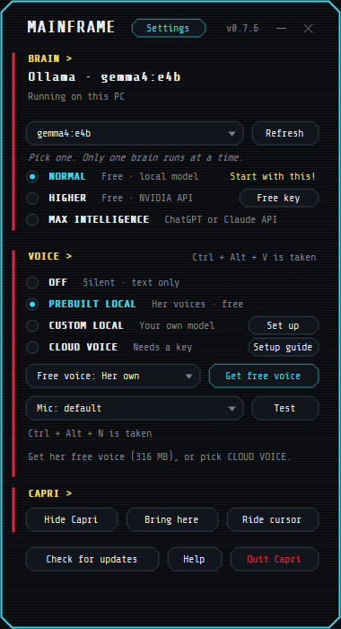

<div align="center">



# Капри (Capri)

**Оживи Капри прямо на своём рабочем столе!**<br>
Она сидит на рамках твоих окон, болтает, свешивает ножки, прикрывает тебя в Discord-звонках, следит за играми и реагирует на всё происходящее на экране.

[](README.en.md)
[](#быстрый-старт-на-windows)
[](#быстрый-старт-на-windows)
[](#подключение-deepseek-api)
[](LICENSE.md)

<sub>Вдохновлено видео jpartnma_ по мотивам Cyberpunk: Edgerunners 2.<br>Оригинальный апстрим-проект: [lachydotmcg/capri-desktop](https://github.com/lachydotmcg/capri-desktop).</sub>

</div>

---

<table align="center">
  <tr>
    <td align="center"><br><sub>Отдыхает</sub></td>
    <td align="center"><br><sub>Разговаривает</sub></td>
    <td align="center"><br><sub>Если потянуть</sub></td>
    <td align="center"><br><sub>Глитч-эффекты</sub></td>
    <td align="center"><br><sub>Спит на окне</sub></td>
  </tr>
</table>

<table align="center">
  <tr>
    <td align="center"><br><sub>Сидит на твоём окне</sub></td>
    <td align="center"><br><sub>Качает в такт музыке</sub></td>
  </tr>
</table>

> [!NOTE]
> Капри — это неофициальный фанатский проект, не связанный и не одобренный CD PROJEKT RED или авторами аниме.

---

## ⚡ Быстрый старт на Windows

Для работы **не нужны** Python, Visual Studio или гигабайты библиотек. Всё компилируется встроенным системным компилятором Windows (`csc.exe` из .NET Framework 4.8):

1. **Скачай или клонируй репозиторий**:
   ```bash
   git clone https://github.com/tessych/capricorn.git
   cd capricorn
   ```
2. **Сборка**:
   Запусти **`build.bat`** — через пару секунд в папке `out\windows\` появится готовый файл `Capri.exe`.
3. **Запуск**:
   Запусти **`run.bat`** (или `out\windows\Capri.exe`). Капри появится на экране и устроится на панели задач или рамке активного окна.

---

## 🧠 Подключение DeepSeek API

Капри поддерживает **DeepSeek API** прямо из коробки:

1. Открой панель управления Капри (**Mainframe**): нажми на чип или на Капри.
2. Перейди во вкладку **BRAIN** → выбери категорию **MAX INTELLIGENCE**.
3. Вставь свой ключ DeepSeek (начинается на `sk-...`) и нажми **Connect**.
4. Капри автоматически определит провайдер DeepSeek, проверит доступные модели (`deepseek-chat`, `deepseek-reasoner`) и подключится. Ключ надёжно сохраняется с шифрованием Windows DPAPI.

> [!TIP]
> Капри говорит и думает на русском языке! В системный промпт характера зашит дерзкий сленг Найт-Сити (*чумба*, *нова*, *эдди*, *корпо*), так что она всегда остаётся тем самым озорным киберпанк-компаньоном, а не скучным чат-ботом.

---

## 🎮 Что умеет Капри

- **Сидит на твоих окнах**: благодаря Win32-физике (`Ledges`) Капри находит края открытых окон (браузера, блокнота, игр), садится на них, свешивает ножки и перемещается вместе с окном.
- **Дерзкий и живой характер**: она не сервильный «голосовой помощник», а твой компаньон. Она подкалывает, шутит, комментирует происходящее и радуется твоим победам.
- **Прикрывает в Discord-звонках**: умеет подключаться к звонкам через виртуальный аудиокабель (VB-Cable) и объяснять друзьям, почему ты отошёл («Hey Capri, join call and tell them I'll be back in 15»).
- **Следит за играми и стримами**: реагирует на происходящее на экране, сохраняет клипы по команде *«clip that»*, играет в мини-игры (шахматы, крестики-нолики).
- **Киберпанк мини-плеер**: стильный полупрозрачный виджет для музыки, на котором Капри качает головой в такт твоим трекам.
- **Поддержка модов**: вкладка **Mods** в Mainframe позволяет скачивать и включать цветовые темы, скины и новые способности.
- **Интеграция с Claude Code и Codex (Husk Mode)**: Капри становится аватаром для инструментов кодинга, отображая статус работы и сообщая о завершении тестов.

<table align="center">
  <tr>
    <td align="center"><br><sub>Киберпанк мини-плеер</sub></td>
    <td align="center"><br><sub>Общение и ввод текста</sub></td>
    <td align="center"><br><sub>Панель Mainframe</sub></td>
  </tr>
</table>

---

## 🖐️ Взаимодействие и управление

- **Клик по Капри**: открыть диалоговое окно для общения текстом.
- **Перетаскивание**: зажми левую кнопку мыши и перетащи её в любое место экрана или на край другого окна.
- **Подбросить**: потяни и резко отпусти курсор — Капри полетит с физикой и приземлится на ближайший выступ.
- **Погладить**: быстро поводи курсором по её голове — она замурлычет и порадуется.
- **Клик правой кнопкой**: открыть меню Mainframe (настройки голоса, нейросети, горячие клавиши, громкость).
- **Клавиша `Esc`**: мгновенно прервать текущую реплику или действие Капри.

---

## 📂 Структура проекта

- **`app/`** — исходный код C# (физика `Ledges.cs`, мозг `Brain.cs`, голос `Voice.cs`, распознавание `Ears.cs`, интерфейс `Mainframe.cs`).
- **`assets/`** — спрайты поз, шрифты (`ShareTechMono`, `Barlow`), звуки и иконки.
- **`ci/build-windows.ps1`** — сценарий сборки автономного исполняемого файла под Windows.
- **`build.bat` / `run.bat`** — запуск и компиляция в один клик.
- **`cross/`** — кроссплатформенная сборка на Avalonia для Linux и macOS.
- **`python-legacy` (ветка)** — архив предыдущей версии на Python.

---

## 🤝 Благодарности и авторство

- Создатель и автор C#-оригинала: **[@lachydotmcg](https://github.com/lachydotmcg)** ([capri-desktop](https://github.com/lachydotmcg/capri-desktop)).
- Художник оригинальных спрайтов Капри (пожелал остаться анонимным).
- Разработчик русскоязычной адаптации: **[@tessych](https://github.com/tessych)** ([capricorn](https://github.com/tessych/capricorn)).
